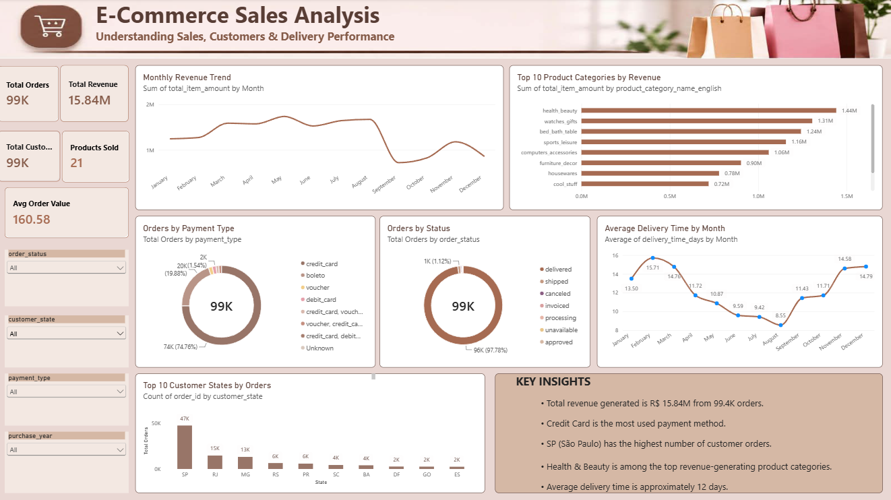

# E-Commerce-Sales-Analysis

An end-to-end data analytics project using Python, Pandas, and Power BI to analyze Brazilian E-Commerce sales data.

Project Overview

This project analyzes e-commerce transactions to understand sales performance, customer behavior, product categories, payment preferences, and delivery trends.

Tools & Technologies

- Python
- Jupyter Notebook
- Pandas and NumPy
- Matplotlib and Seaborn
- Power BI

Project Workflow

1. Data Collection
2. Data Cleaning and Preprocessing
3. Exploratory Data Analysis (EDA)
4. Feature Engineering
5. Data Visualization
6. Interactive Dashboard Development

Key Performance Indicators

- Total Orders
- Total Revenue
- Total Customers
- Average Order Value
- Products Sold

Dashboard Features

- Monthly Revenue Trend
- Top Product Categories by Revenue
- Orders by Payment Type
- Orders by Status
- Average Delivery Time
- Top Customer States by Orders
- Interactive Filters

 ## Dashboard Preview

Project Files

- "Ecommerce_Sales_Analysis.ipynb" – Python analysis notebook
- "Dashboard.png" – Power BI dashboard preview

Dataset

Brazilian E-Commerce Public Dataset by Olist, available on Kaggle.

Author

Niharika Negi
